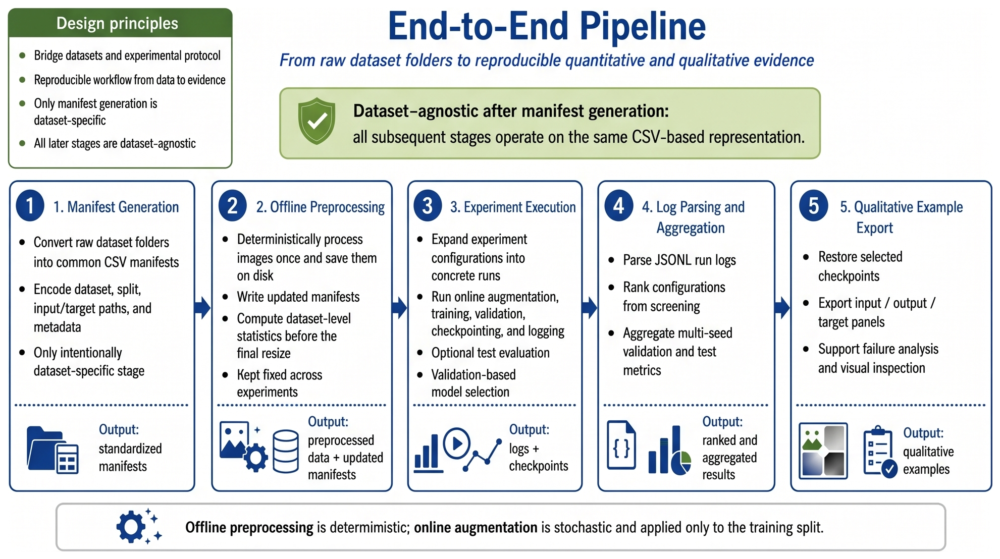
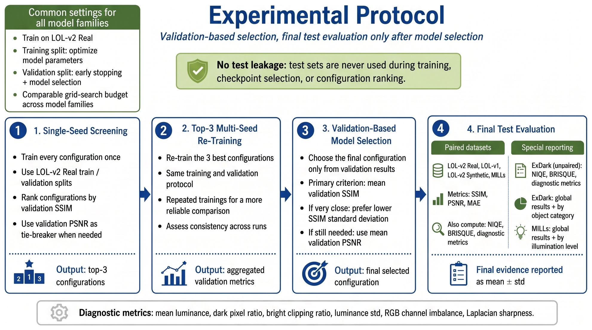
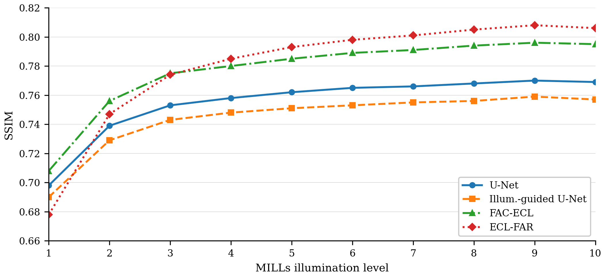

# Low-Light Image Enhancement with Cross-Dataset Generalization

This **PyTorch** computer-vision project compares four low-light image enhancement model families under a common experimental protocol, with validation-based model selection and cross-dataset evaluation. The code implements dataset ingestion, offline preprocessing, training, checkpointing, evaluation, JSONL logging and analysis of experimental results.

Developed at **[Politecnico di Bari](https://www.poliba.it/en/laurea-magistrale-ingegneria-informatica)** as part of the **Master's Degree in Computer Engineering**, **Artificial Intelligence and Data Science** curriculum, for the *Deep Learning* course (Academic Year **2023–2024**).

> **Data and publishing:** Dataset photographs are acquired separately from the original publishers. The repository includes code, experimental logs, result summaries, the university report, and its LaTeX sources; raw and preprocessed dataset photographs are not included. Publishing per-image metadata or report figures may require additional rights clearance. See [dataset sources](THIRD_PARTY_DATASETS.md) and [publication rights](docs/publication-rights.md). Historical result values are reported as recorded, not as newly rerun experiments.

## Motivation and Approach

Low-light image enhancement must improve visibility without compromising color, noise structure or natural image appearance. Models that score well on a familiar dataset may fail under changes in camera characteristics, exposure and noise. This project investigates those differences by training on **LOL-v2 Real** and testing under distinct image conditions.

Four methods share the same experiment infrastructure:

| Model family | Implemented approach |
|---|---|
| **U-Net** | Encoder–decoder baseline with configurable channel depth, normalization and upsampling |
| **Illumination-guided U-Net** | RGB input augmented with an estimated luminance or maximum-RGB illumination channel |
| **FAC-ECL** | Frequency-aware and exposure-consistency loss terms on top of a U-Net backbone |
| **ECL-FAR** | Photometric sensitivity-guided feature refinement with exposure-consistency terms, investigated as the project's proposed approach |

This project implements the methods described here; it does **not** claim authorship of foundational U-Net techniques or third-party datasets.



*Data preparation, training, evaluation and analysis pipeline.*

## Pipeline and Experiment Design

The framework is divided into manifest generation, standardized offline image preprocessing, GPU-capable training/validation, checkpointing, metric-based evaluation, JSONL log parsing, and qualitative analysis. The 256 × 256 preprocessing uses RGB conversion and LANCZOS resizing, with original-resolution luminance statistics. Online augmentation runs on training examples only. The experiments use AdamW, mixed precision where supported, validation monitoring, and early stopping.



*Validation-based configuration selection and final evaluation. LOL-v1 is a non-independent overlap control, not evidence of independent cross-dataset generalization.*

Historical protocol across all four model families:

1. **Screening:** 144 hyperparameter combinations per family at seed 0 (576 runs).
2. **Multi-seed selection:** Top three per family retrained with seeds 1, 2 and 3 (36 runs).
3. **Configuration selection:** Based on mean validation SSIM, stability and validation PSNR; no test data used for hyperparameter selection.
4. **Final evaluation:** 12 seed-specific checkpoint evaluations (three per selected family) over the common test suite.

The full screening YAMLs live in [`configs/experiments/`](configs/experiments/). Four single-run files in [`configs/selected/`](configs/selected/) specify the **selected hyperparameters** for training. The four selection hashes were verified against the archived final-evaluation logs. See [`docs/experiments.md`](docs/experiments.md) for provenance, caveats and artifact availability.

## Datasets

| Dataset | Role | Pairing | Historical sample counts |
|---|---|---|---|
| LOL-v2 Real | Training, validation and in-domain test | Paired | 620 train / 69 validation / 100 test |
| LOL-v2 Synthetic | Cross-dataset test | Paired | 100 test (the historical manifest also includes separate 810/90 non-training splits) |
| MILLs | Cross-dataset test, analyzed by illumination level | Paired | 499 test |
| ExDark | Unpaired low-light stress test, analyzed by category | Unpaired | 7,363 test |
| LOL-v1 | Non-independent overlap-control test | Paired | 500 test |

LOL-v1 overlaps with LOL-v2 Real and is **not evidence of independent cross-dataset generalization**. The model was trained only on LOL-v2 Real; other dataset splits were not used to train it. Because ExDark has no target image, full-reference metrics such as SSIM and PSNR cannot be computed there.

Datasets, photographs, metric model assets and original annotations belong to their respective owners. Raw and preprocessed dataset images are not redistributed. **Download the datasets and follow the exact directory layout below** to run the manifest builder and preprocessing without changing the experiment configuration. See also [`THIRD_PARTY_DATASETS.md`](THIRD_PARTY_DATASETS.md) for rights and source attribution.

### Obtain and Place the Datasets

The pipeline does **not** download third-party image datasets. Download the archives yourself from the original publishers, follow the access and usage terms, extract them, and copy/rename the **directory containers** to match the paths below. Do not rename the image files or change image pairings. The two LOL-v2 variants are provided together in the original LOL-v2 download.

| Dataset | Official download page or archive | Destination after extracting and organizing |
|---|---|---|
| LOL-v1 (485 training + 15 evaluation pairs) | [Retinex-Net project / LOL download](https://daooshee.github.io/BMVC2018website/) · [official Google Drive archive](https://drive.google.com/file/d/157bjO1_cFuSd0HWDUuAmcHRJDVyWpOxB/view) | `data/raw/lol_v1/` containing `our485/{low,high}` and `eval15/{low,high}` |
| LOL-v2 Real and Synthetic | [official LOL-v2 link documented by the authors](https://github.com/flyywh/CVPR-2020-Semi-Low-Light) · [official Google Drive archive](https://drive.google.com/file/d/1dzuLCk9_gE2bFF222n3-7GVUlSVHpMYC/view) | `data/raw/lol_v2/real_captured/` and `data/raw/lol_v2/synthetic/`, each with `train/{low,normal}` and `test/{low,normal}` |
| MILLs (small, DSLR) | [MILL official project](https://github.com/CVC-Color/MILL) · [MILLs-DSLR ZIP](https://datasets.cvc.uab.cat/color/MILLs-DSLR.zip) · [Hugging Face](https://huggingface.co/datasets/davidserra9/MILL) | `data/raw/mill_s/` containing `train/`, `validation/`, `test/`, each with `input/` and `gt/` |
| ExDark | [official ExDark dataset instructions](https://github.com/cs-chan/Exclusively-Dark-Image-Dataset/blob/master/Dataset/README.md) · [official Google Drive archive](https://drive.google.com/file/d/1BHmPgu8EsHoFDDkMGLVoXIlCth2dW6Yx/view) | `data/raw/ex_dark/` with the 12 lowercase category directories |

Some providers require browser access or login; the links point to publisher-hosted resources, **not** a repository-controlled automatic downloader. Use the actual image archives, not the source-code ZIP of the dataset authors' GitHub repository. For MILL, use **MILLs-DSLR** (the small DSLR version), not MILLf or the smartphone variant; the authors omit the corrupt `Test13-9.png` sample.

Exact raw directory structure expected by [`configs/data/datasets.yml`](configs/data/datasets.yml) (the names and case of the directory levels matter):

```text
data/
└── raw/  # Downloaded source images (not included)
    ├── lol_v1/
    │   ├── our485/
    │   │   ├── low/  # Paired low-light filenames
    │   │   └── high/  # Same filenames as in low/
    │   └── eval15/
    │       ├── low/
    │       └── high/
    ├── lol_v2/
    │   ├── real_captured/
    │   │   ├── train/
    │   │   │   ├── low/  # e.g. low00001.png
    │   │   │   └── normal/  # e.g. normal00001.png
    │   │   └── test/
    │   │       ├── low/
    │   │       └── normal/
    │   └── synthetic/
    │       ├── train/
    │       │   ├── low/  # Same filename as its normal/ pair
    │       │   └── normal/
    │       └── test/
    │           ├── low/
    │           └── normal/
    ├── mill_s/
    │   ├── train/
    │   │   ├── input/  # e.g. scene10_a-10.png
    │   │   └── gt/  # e.g. scene10_a.png
    │   ├── validation/
    │   │   ├── input/
    │   │   └── gt/
    │   └── test/
    │       ├── input/
    │       └── gt/
    └── ex_dark/
        ├── bicycle/
        ├── boat/
        ├── bottle/
        ├── bus/
        ├── car/
        ├── cat/
        ├── chair/
        ├── cup/
        ├── dog/
        ├── motorbike/
        ├── people/
        └── table/
```

The publisher archive may use capitalization such as `Real_captured`, `Train`, `Low` or `Bicycle`: normalize **folder names** to the lowercase layout above, while leaving image filename spelling/case intact. Do not flatten the 12 ExDark classes or the MILLs split directories. The manifest builder pairs LOL-v1 by identical filenames, LOL-v2 Real by `low...` → `normal...`, LOL-v2 Synthetic by identical filenames, and MILLs by stripping the final `-<illumination-level>` suffix. The manifest builder skips unrelated non-image files and stops with a diagnostic if a required image directory or paired target is missing. It also refuses to replace an existing manifest with fewer rows unless explicitly called with `--allow-smaller-manifests`.

### Generate and Use the CSV Manifests and Preprocessed Images

Run the two commands from the **repository root**, after installing the dependencies and populating `data/raw/`:

```bash
python scripts/build_manifests.py --config configs/data/datasets.yml
python scripts/preprocess_offline.py --config configs/data/preprocess.yml --no-progress-bar
```

The first command creates one CSV per dataset in `data/manifests/`; the second produces 256 × 256 PNG images plus CSVs with the *processed* paths in `data/preprocessed/`:

```text
data/
├── manifests/  # Five included manifest CSVs
│   ├── ex_dark.csv
│   ├── lol_v1.csv
│   ├── lol_v2_real.csv
│   ├── lol_v2_synthetic.csv
│   └── mill_s.csv
└── preprocessed/
    ├── dataset_summary.csv  # Included summary and manifest CSVs
    ├── ex_dark.csv
    ├── lol_v1.csv
    ├── lol_v2_real.csv
    ├── lol_v2_synthetic.csv
    ├── mill_s.csv
    ├── ex_dark/  # Locally generated image subdirectories
    │   └── <category>/*.png
    ├── lol_v1/  # Images follow our485/ and eval15/
    ├── lol_v2_real/  # Images follow train/ and test/
    ├── lol_v2_synthetic/  # Images follow train/ and test/
    └── mill_s/  # Images follow train/, validation/, test/
```

`data/manifests/*.csv` and `data/preprocessed/*.csv` are included in this repository; `data/raw/` and the processed image directories are not. Keep the CSV files consistent with the image paths they reference. This repository includes all five raw-data manifests, their five preprocessed CSVs, and `dataset_summary.csv`. The referenced dataset images are not included: download the original images and regenerate preprocessing outputs before training or evaluation. The commands validate the downloaded files before overwriting CSVs; if you intentionally use a smaller dataset, pass `--allow-smaller-manifests` to the manifest builder. Otherwise, resolve any missing files before continuing. Check the CSV paths before using them with the data loader; do not treat `dataset_summary.csv` as an input manifest.

**Publishing note:** Keep downloaded dataset images, generated processed images, locally produced checkpoints, caches and temporary files local. Before committing changes, inspect `git status` and stage only the intended source files, documentation, CSVs and results.

**Kaggle:** [`run_experiments_kaggle.ipynb`](run_experiments_kaggle.ipynb) documents the same folder layout. Mount a Kaggle Input containing the *content* of `data/raw/`, set `RAW_DATA_DIRECTORY` to that folder, and enable `RUN_MANIFEST_GENERATION` and `RUN_OFFLINE_PREPROCESSING`. Alternatively, mount a dataset with `data/preprocessed/` containing **both** the CSVs and all processed images and point `PREPROCESSED_DATA_DIRECTORY` to that folder. Dataset files copied into `/kaggle/working/<repo>/data/` remain local to the Kaggle execution. Respect each publisher's terms and Kaggle visibility settings.

## Historical Experimental Results

The values below are historical **mean SSIM across three seed evaluations** from `parsed_logs/*_final_eval.csv` (higher is better). They were extracted from the archived experiment logs and **have not been recomputed in a new evaluation**.

| Family | LOL-v2 Real (test) | LOL-v2 Synthetic (test) | MILLs (test) |
|---|---:|---:|---:|
| U-Net | 0.8487 | **0.7657** | 0.7547 |
| Illumination-guided U-Net | 0.8408 | 0.7610 | 0.7439 |
| FAC-ECL | **0.8513** | 0.7628 | 0.7769 |
| ECL-FAR | 0.8508 | 0.7472 | **0.7796** |

There is **no universally best model**: FAC-ECL achieved the highest SSIM on LOL-v2 Real, U-Net on LOL-v2 Synthetic, and ECL-FAR on MILLs. Metrics on the unpaired ExDark dataset include NIQE, BRISQUE and diagnostics, not paired SSIM/PSNR. Seed means, dispersions, per-group metrics and other quality indicators are available in [`parsed_logs/`](parsed_logs/). Avoid treating a single metric or dataset as a general performance guarantee.



*Historical SSIM by MILLs illumination level.*

## Repository Structure

```text
configs/data/  # Dataset mapping and preprocessing
configs/experiments/  # Original seed-0 screening grids
configs/selected/  # Single-run retraining configs from historical selections
data/manifests/  # Five tracked raw-data CSV manifests
data/preprocessed/  # Included CSVs; images generated locally
scripts/  # CLI entry points
src/low_light_enhancement/  # Framework, model wrappers and parsers
experiment_logs/  # Historical per-run JSONL logs (624 files)
logs/  # New experiment logs, tracked when created
parsed_logs/  # Historical CSV summaries and JSON analyses
report/  # University PDF, LaTeX sources and all report figures
docs/  # Reproducibility and experimental provenance
tests/  # Automated unit and contract tests
run_experiments_kaggle.ipynb  # Opt-in Kaggle pipeline notebook
```

The project uses the `src.low_light_enhancement` import path consistently across its experiment scripts and framework modules. All commands assume execution from the repository root.

## Getting Started

Use **Python 3.13**. The supplied `requirements.txt` pins PyTorch **2.12.0** using the **CUDA 12.6** wheel index, together with the other project dependencies. Use a compatible operating system and NVIDIA driver for CUDA execution; select the appropriate PyTorch build for your platform if necessary.

```bash
python -m venv .venv
source .venv/bin/activate  # Windows: .venv\Scripts\activate
python -m pip install -r requirements.txt
```

No `.env` file is needed. Experiment settings are specified in the YAML files under `configs/` and in the CLI options; Kaggle-specific settings are defined in the notebook.

Some `pyiqa` evaluation metrics may download their pretrained metric assets at runtime. See [`docs/reproducibility.md`](docs/reproducibility.md) for platform, Kaggle and dataset setup instructions.

## Usage

**1. Download and organize the datasets** using [the official links and raw-data tree above](#obtain-and-place-the-datasets), then generate CSV manifests and 256 × 256 PNGs:

```bash
python scripts/build_manifests.py --config configs/data/datasets.yml
python scripts/preprocess_offline.py --config configs/data/preprocess.yml --no-progress-bar
```

**2. Check the number of runs before starting training:**

```bash
python scripts/start_experiments.py --config configs/experiments/unet.yml --dry-run
python scripts/start_experiments.py --config configs/selected/unet.yml --dry-run
```

The original screening YAML expands to 144 expensive runs; the selected U-Net YAML expands to one retraining run (seed 1, with early stopping). This selected run still may require significant GPU compute.

**3. Train one selected model** only when local data and compute resources are ready:

```bash
python scripts/start_experiments.py --config configs/selected/unet.yml --no-progress-bar
```

Use `illumination_guided_unet`, `fac_ecl`, or `ecl_far` in place of `unet` for the other selected families. Training outputs are written under `logs/` and `checkpoints/`; do not commit locally generated checkpoint files.

**4. Analyze new logs** using the same parsing framework:

```bash
python scripts/parse_logs.py --parsing-mode screening \
  --logs-dir logs/<experiment-name> \
  --output-name my_screening.csv
```

Available parsers: `screening`, `multi_seed`, `final_eval`, and `failure_candidates`. The corresponding log event structures and prerequisite files vary by mode.

Qualitative export uses model weights produced by training or otherwise legitimately obtained checkpoint files. Run `python scripts/export_qualitative_examples.py --help` and `python scripts/export_variant_comparison_panel.py --help` for usage; the latter supports deterministic `--seed` and non-destructive output behavior with an explicit `--overwrite` option.

## Tests

```bash
python -m pip install -r requirements-dev.txt
python -m pytest -q
```

The test suite covers configuration expansion and selection, preprocessing on generated images, model interfaces, checkpoint RNG restoration, and export safeguards. Dataset acquisition and execution instructions are available in [`docs/reproducibility.md`](docs/reproducibility.md).

## Documentation

The [university report (English, PDF)](report/main.pdf), [LaTeX source](report/main.tex) and [scientific bibliography](report/main.bib) are included in the repository, with `cvpr.sty`, `ieeenat_fullname.bst`, figure sources and all figures required for compilation. This is a **university report prepared in a CVPR-style template**, not an accepted CVPR publication. See the [report build instructions](report/README.md).

`experiment_logs/` contains 624 archived JSONL files; `parsed_logs/` contains the original CSV summaries and failure-candidate JSON files. `logs/` is ready for subsequent experiment runs. Raw and preprocessed dataset **images**, along with bulk `qualitative/` image exports, are not included in this distribution. The eleven original CSV manifests and dataset summary are included.

**Publication caveat:** Report figures and PDF pages that depict third-party images, and some per-image metadata in manifests/logs, can have rights restrictions independent of the dataset file exclusion. Inclusion here does **not** establish redistribution permission. Review [`docs/publication-rights.md`](docs/publication-rights.md) before making the repository public. Excluding source image folders from this distribution does not replace this rights review.

This repository documents an academic experimental pipeline, not a production service. Repeating reported values depends on dataset versions, runtime, compute environment and the documented experimental procedure.

## Contributors

- [Cosimo Curri](https://github.com/cosimo-curri)

## License and Third-Party Materials

The original project code is licensed under the [MIT License](LICENSE). Third-party materials remain subject to their respective licenses and terms.

The study builds on published computer-vision research (including U-Net and low-light enhancement techniques), third-party datasets (LOL-v1, LOL-v2, MILL, ExDark), and open-source frameworks such as PyTorch, Pillow and `pyiqa`. These authors and maintainers are **not** claimed as project collaborators. Original research citations are in [`report/main.bib`](report/main.bib); data attribution and access terms are in [`THIRD_PARTY_DATASETS.md`](THIRD_PARTY_DATASETS.md).

Third-party CVPR template components are credited in `report/README.md` and retain their respective distribution conditions.
